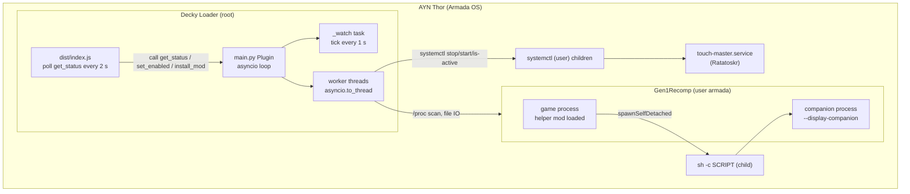

# 01 - Architecture and modules

## Components

| Component | Runs in | Language | Path |
|---|---|---|---|
| Decky frontend | Decky Loader's UI (Steam Deck UI on the Thor) | JavaScript (plain, no build) | `dist/index.js` |
| Decky backend | Decky Loader's plugin process, as root | Python 3 | `main.py` |
| Helper mod | The Gen1Recomp process (game and companion copies) | Lua | `mod/thor_bottom_companion/main.lua` |
| Launch shim | A `sh -c` child started by the mod | POSIX shell | string `SCRIPT` in `main.lua:31-40` |
| Deploy tool | Developer machine, then the Thor over SSH | Bash | `scripts/deploy.sh` |

The plugin and the mod never call each other directly. The contract between them is the flag file and the `--display-companion=` argument (see [02](02-protocols-data-formats.md)).

## Backend modules (`main.py`)

| Section | Lines | Responsibility |
|---|---|---|
| Configuration constants | `main.py:23-45` | Paths, UID, env overrides, service names, release grace |
| Pure helpers | `main.py:48-173` | Shortcut parsing, game folder lookup, `/proc` readers, scan, mod-in-options check, file diff, mod install, flag file |
| systemd access | `main.py:176-195` | `run_systemctl`, `unit_active` |
| `Plugin` class | `main.py:198-304` | State, watcher, park/restore, status, Decky entry points |

Helpers are module-level functions, which makes them testable with a fake `/proc` and a fake home (`tests/test_backend.py:12-17`). Dependencies that touch the system are injected as attributes on `Plugin`:
- `self.systemctl` (default `run_systemctl`, `main.py:205`)
- `self.scan` (default `scan_processes`, `main.py:206`)

The `Plugin` methods that the frontend calls do not take these as parameters. Only `unit_active` takes an injectable `systemctl` argument (`main.py:193`).

## Frontend (`dist/index.js`)
- Connects to the Decky API through the global `window.__DECKY_SECRET_INTERNALS_DO_NOT_USE_OR_YOU_WILL_BE_FIRED_deckyLoaderAPIInit` (`dist/index.js:3`). It throws if that global is missing (`:4-6`).
- Tries API version 2 and falls back to 1 (`:8-12`).
- Uses `SP_REACT`, `SP_JSX`, and `DFL` globals from the Decky frontend runtime (`dist/index.js:21-22`, `:25`, `:57`). Those globals are provided by the loader; their contract is **unverified** here.
- One component `Content` with local state (`status`, `busy`), polling `get_status` every 2 s (`:24-41`).
- No persistent frontend state.

## Lua mod (`mod/thor_bottom_companion/main.lua`)
- Returns a function taking `mod`. Requires `src.core.HostShell` (`main.lua:18-19`), an engine module that is not in the repo (**unverified** API beyond what `tests/test_mod.lua:9-16` stubs: `spawnSelfDetached`, `isWindows`, `quote`, `popen`, `pclose`).
- Uses `mod.log:info` and `mod.log:warn` (`main.lua:58`, `:61`).
- Wraps `HostShell.spawnSelfDetached` once. The original is kept on `HostShell._thorBottomCompanionOriginal` (`main.lua:22`, `:25`).
- Holds no state beyond that guard. No `io` or `os` calls (`main.lua:14-16`).

## Process and thread model

Threading facts from code:
- `_main` starts one watcher task (`main.py:209-210`). `_watch` runs `tick` through `asyncio.to_thread` once a second, then sleeps 1.0 s (`main.py:215-221`).
- `get_status`, `set_enabled`, `install_mod`, and `_unload` each run their work through `asyncio.to_thread` (`main.py:213`, `:283`, `:297`, `:304`).
- The `Plugin` object is therefore touched from several threads. No lock exists (`main.py:200-206`). See [06](06-roadmap.md) for the consequence to check.

## State

| State | Where | Lifetime |
|---|---|---|
| Switch | File `FLAG` (`main.py:29`) | Persists across restarts |
| Parked | `Plugin.parked` (`main.py:202`) | In memory. A restart of the Decky backend loses it, and Ratatoskr is not restarted by the new process (**unverified** behaviour across restarts; the code has no startup check). |
| Quiet tick counter | `Plugin.quiet_ticks` (`main.py:203`) | In memory |
| Last process scan | `Plugin.last_scan` (`main.py:204`, updated in `tick` and `_status`) | In memory |
| Game-installed mod | Files under `<game_dir>/mods/thor_bottom_companion/` | On disk |
| Guard against double wrap | `HostShell._thorBottomCompanionOriginal` (`main.lua:22`) | In the Gen1Recomp process |

## Dependencies on other software (not in the repo)

| Dependency | How it is used | Evidence |
|---|---|---|
| Decky Loader | Plugin lifecycle (`_main`, `_unload`), RPC `call`, `toaster` | `main.py:209-213`, `dist/index.js:9-14`, `:48` |
| Gen1Recomp | Provides `HostShell`, spawn of companions, the mods system | `main.lua:18-25`; `README.md` |
| Kanto Gear | Companion UI, selected by the user's display mode | `README.md` |
| Armada OS | `armada-run-bottom`, the bottom gamescope, the env file | `main.lua:33-35`; `main.py:109` |
| systemd (user) | `touch-master.service`, `armada-bottom-screen.service` | `main.py:37-38`, `:178-190` |
| Steam | `shortcuts.vdf` for the AppImage location | `main.py:32`, `:65-76` |
