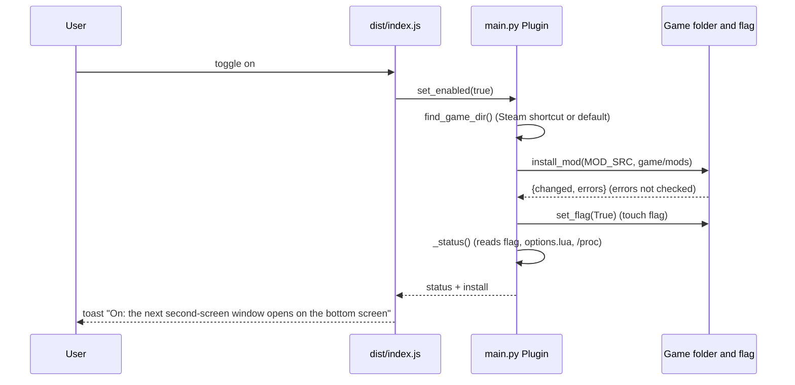
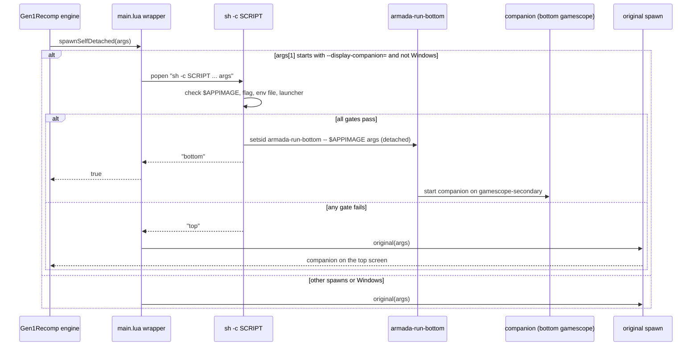
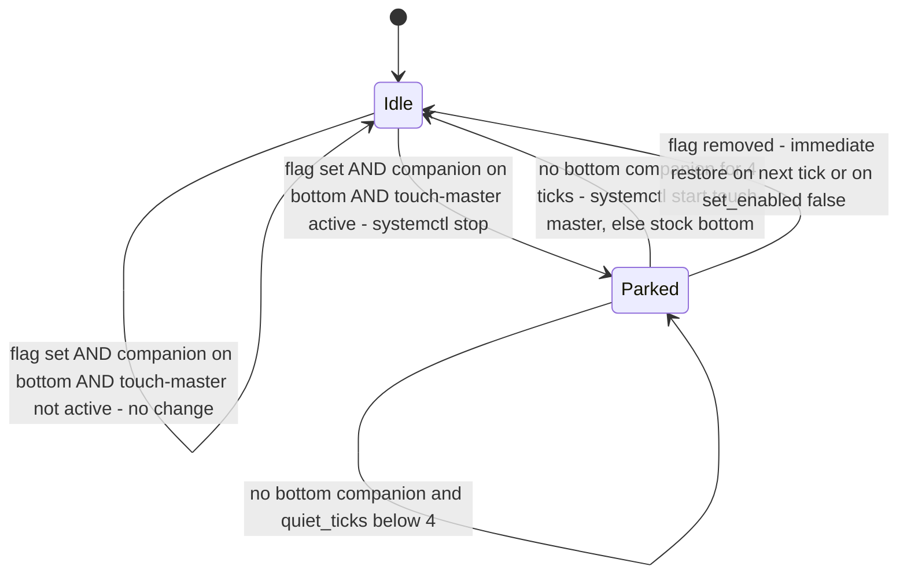
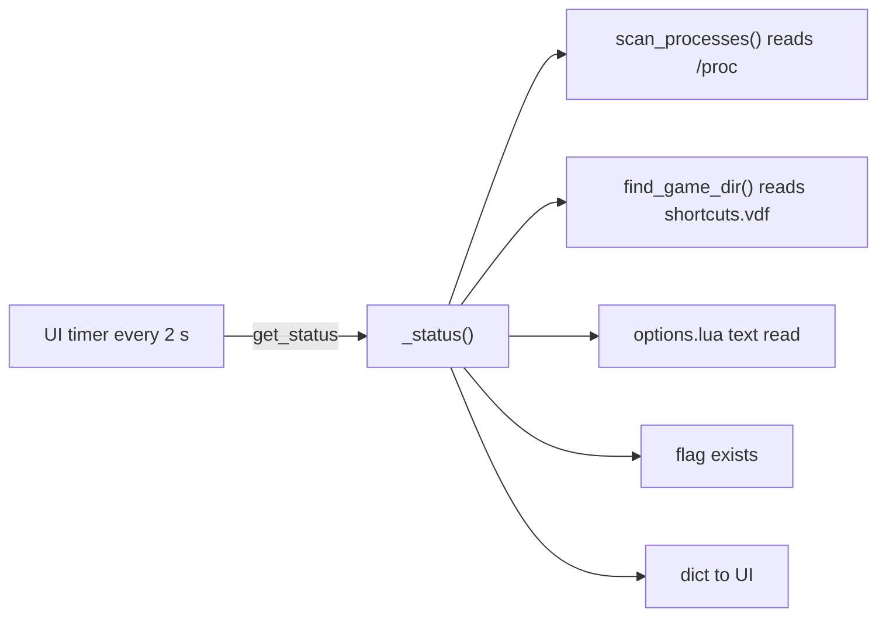
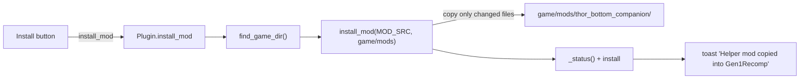

# 03 - Data flow

## 1. Enable path (user switches the toggle on)

Source: `main.py:285-293`, `dist/index.js:63-64`.

## 2. Companion launch path (game running, engine opens companion)

Source: `main.lua:42-62`, `main.lua:31-40`. The return value of the original function is not known to the mod (**unverified** engine contract).

## 3. Park and restore (Ratatoskr)

Source: `main.py:226-248`. Thresholds: `RELEASE_AFTER_TICKS = 4` (`main.py:40`), tick interval 1 s (`main.py:221`).

Ticks checked by `tests/test_backend.py:122-183`: park, release after the grace period, no bounce on a one-tick gap, no park when the flag is off, no start of a unit the backend did not stop, fallback to the stock bottom service, and immediate restore when the flag is cleared.

## 4. Status poll

Source: `dist/index.js:37-41`, `main.py:250-280`. Cost **unverified**. The watcher also calls `scan_processes` once a second (`main.py:228`).

## 5. Install path (button)

Source: `main.py:299-304`, `dist/index.js:83-92`. The flag is not changed on this path.

## 6. Data at rest and in transit

| Data | Location | Format | Crosses a boundary |
|---|---|---|---|
| Switch | `$HOME/.config/kanto-gear-bottom/enabled` | empty file | Read by backend and shell |
| Mod | Repo `mod/` to game `mods/` | files, byte copy | Plugin to game (same device) |
| Status | Backend to UI | JSON-compatible dict | Decky RPC |
| Companion argv | Engine to mod to shell | string array, shell-quoted | In-process to child process |
| Process table | Kernel `/proc` | NUL-separated | Read-only |
| Systemd state | `systemctl` output | text | Subprocess |

No network, no database, no persisted logs written by the plugin (the Lua mod logs via `mod.log`, destination **unverified**).
